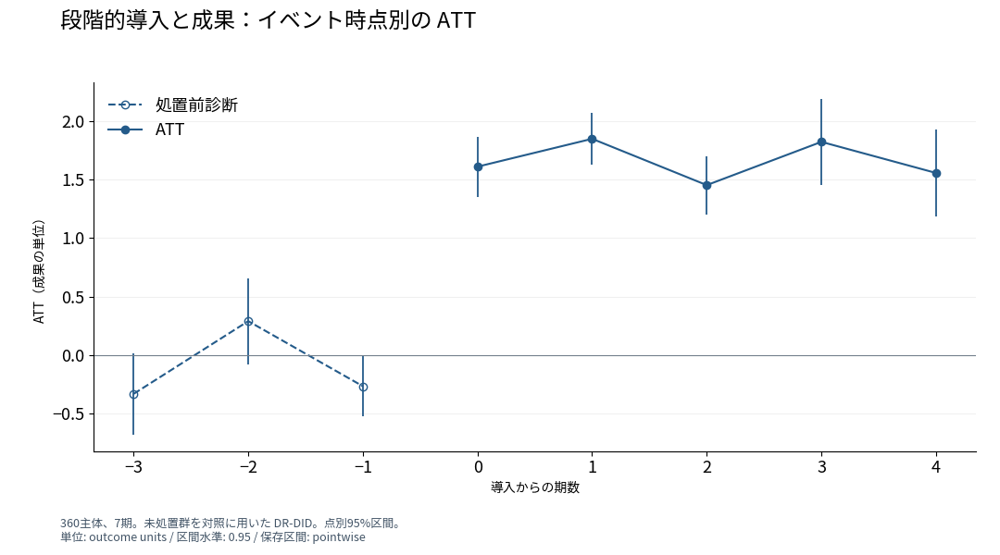
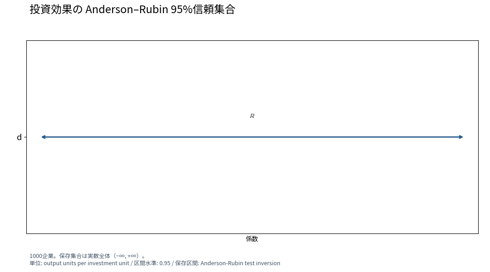
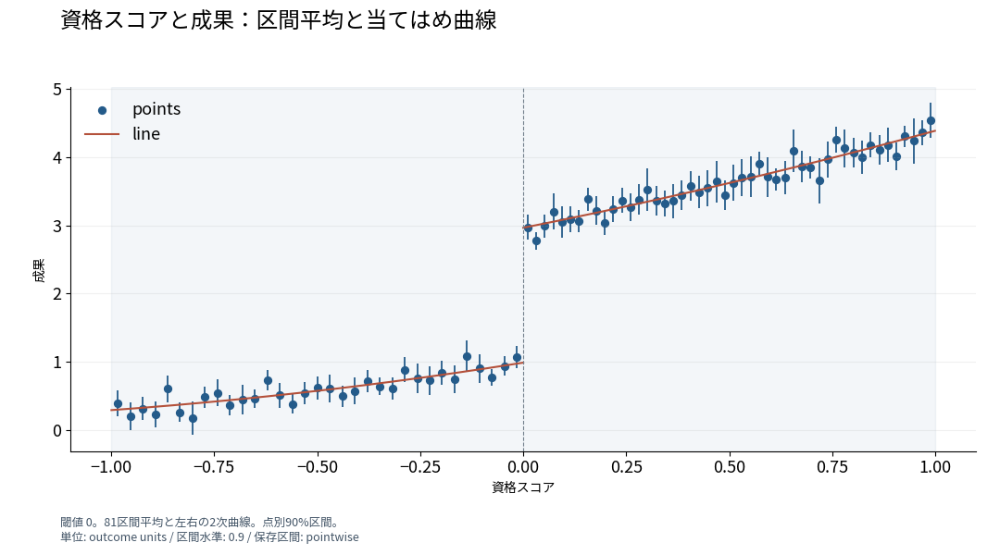
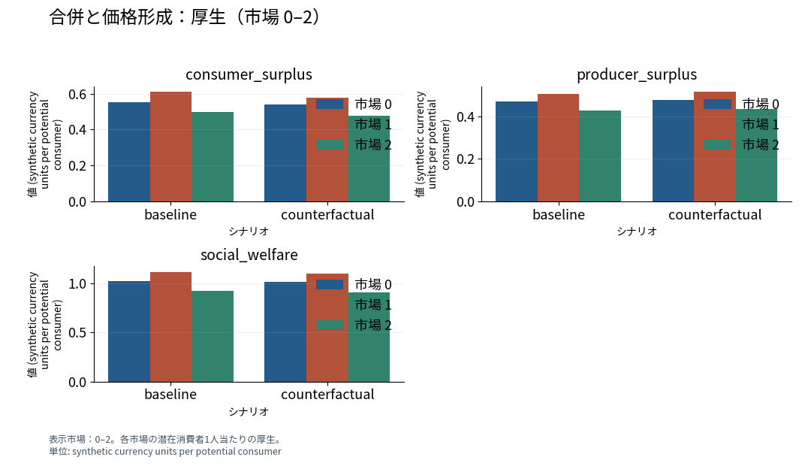
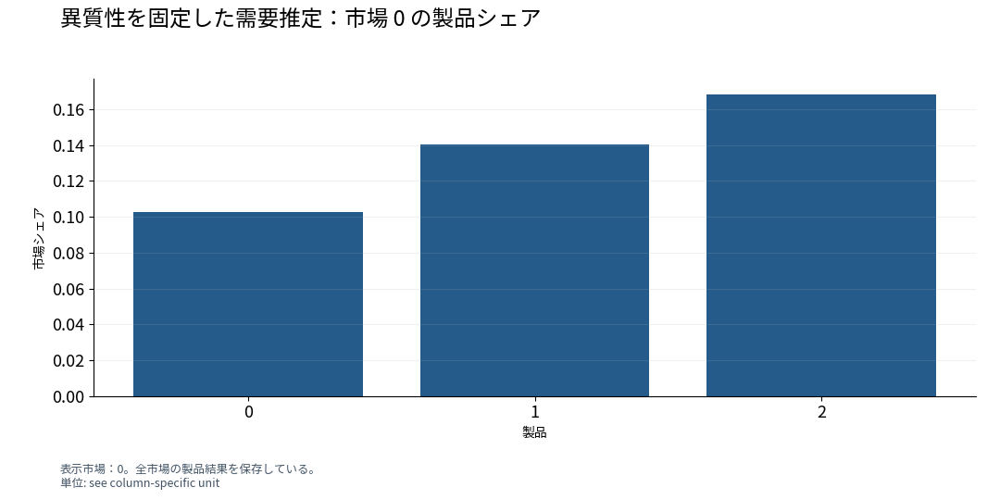
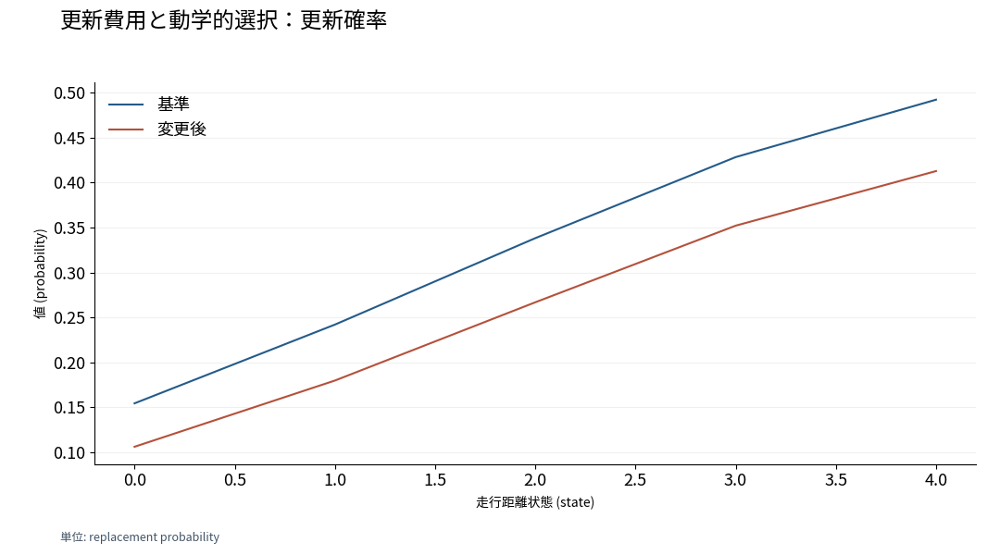
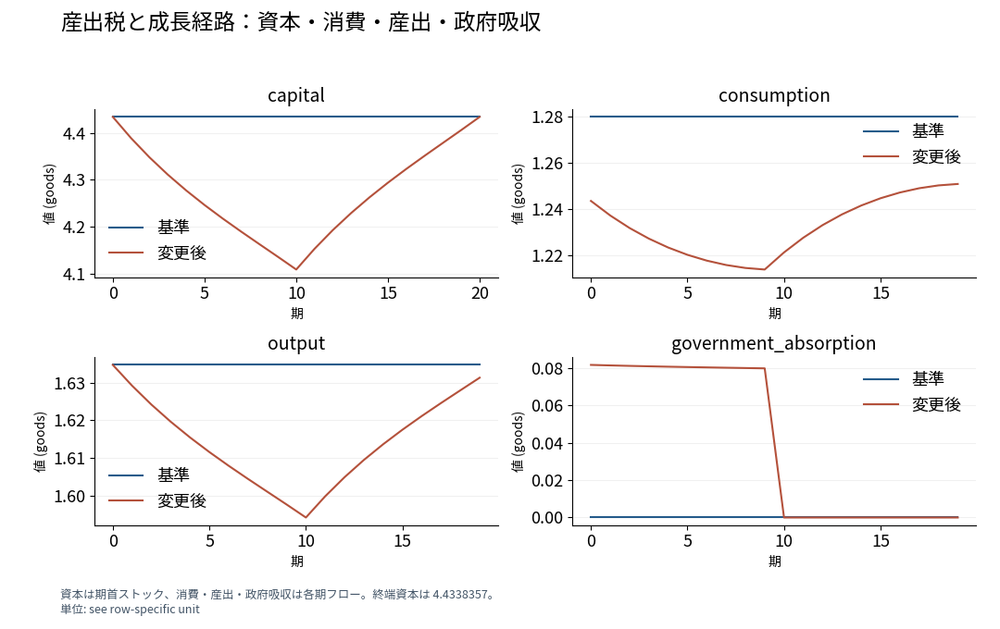
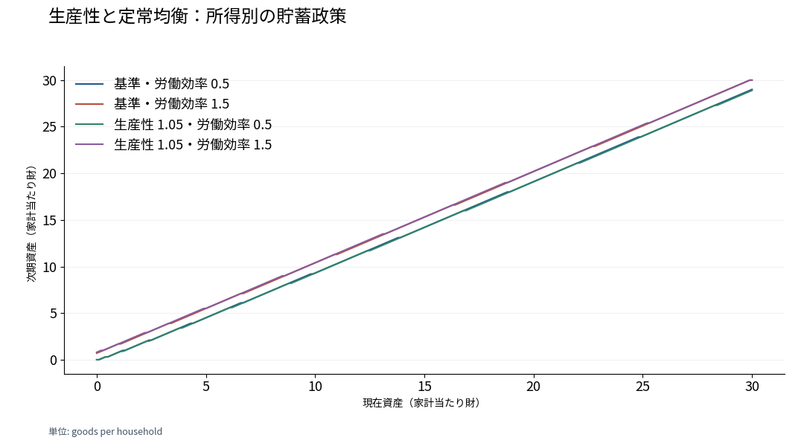

# 合成経済の推定と均衡比較

2026-11-07

## 研究質問と採用した経済モデル

8つの合成経済は、それぞれの研究質問に対応する入力仕様、推定・較正、比較条件を持つ。各ケースの表図は、同じ結果 ID の推定値・政策・均衡・厚生を示す。

| 研究対象 | 採用した計算 |
| --- | --- |
| 段階的導入 | DR-DID と動学 ATT |
| 投資と費用シフター | Anderson–Rubin 集合 |
| 資格の閾値 | sharp RDD |
| 所有統合 | 需要・供給 GMM と価格均衡 |
| 消費者の異質性 | 固定した異質性係数と需要推定 |
| 更新費用 | NFXP・CCP と動学政策 |
| 一時的な産出税 | 有限期間の家計最適化 |
| 生産性 | Aiyagari 定常均衡 |

## 1　段階的導入と効果の時間構造

360主体・7期。未処置群を対照とする DR-DID、点別95%区間。導入後の平均 ATT は 1.6588。導入期 1.6110、翌期 1.8491。処置前共同検定 p=0.11917。

360主体、7期。未処置群を対照に用いた DR-DID。点別95%区間。標本: id_column: id, input_rows: 2520, observations: 360、母集団: seeded simulated units、期間: simulated、単位: outcome units、推定対象: group-time ATT and event-time average effects、推定方法: staggered_did、信頼区間: 0.95、推論: confidence_level: 0.95, interval_type: pointwise, overall_interval_type: pointwise, reference: normal, standard_error_method: analytical、区間の種類: pointwise、集計: dynamic。結果ID: specialist-did-r01

## 2　費用シフターと投資効果の信頼集合

1,000企業、共変量 x、除外操作変数 z。第一段階の頑健 F は 0.045499。Anderson–Rubin の95%集合は実数全体。2SLS 係数 -1.2621、標準誤差 15.6727。

1000企業。保存集合は実数全体（−∞, +∞）。標本: id_column: id, included_rows: 1000, observations: 1000、母集団: 1000 simulated firms、期間: one simulated choice occasion、単位: output units per investment unit、推定対象: Anderson-Rubin confidence set for the linear structural investment coefficient、推定方法: ivDiag::AR_test、信頼区間: 0.95、N: 1000、推論: type: official、重み: 、区間の種類: Anderson-Rubin test inversion、推論単位: id。結果ID: specialist-weak-iv-r01

## 3　資格の閾値における局所効果

閾値0、1,600申請者。局所線形・バイアス補正・三角カーネル。効果 1.9059、頑健標準誤差 0.1076、90%区間 [1.7290, 2.0828]。推定帯域内は左245人・右252人。

閾値 0。81区間平均と左右の2次曲線。点別90%区間。標本: included_ids_available: False, input_rows: 1600, observations: 1600、母集団: 1600 simulated applicants near the eligibility cutoff、期間: one simulated choice occasion、単位: outcome units、推定対象: Binned outcome means and left/right polynomial conditional means、推定方法: rdrobust::rdrobust、信頼区間: 0.9、N: 1600、推論: type: official、重み: 、区間の種類: pointwise、cutoff: 0、bandwidth: 0.99902840687904, 0.9987830162091345。結果ID: specialist-rdd-r01

## 4　所有統合による価格と厚生の変化

120市場の需要・供給 GMM。企業0・1を統合し、推定限界費用を固定。市場0の消費者余剰 0.5500 → 0.5388、総余剰 1.0220 → 1.0154。価格勾配残差 7.5e-14。

表示市場：0–2。各市場の潜在消費者1人当たりの厚生。母集団: Potential consumers within each market、単位: synthetic currency units per potential consumer、モデル契約: MC-pyblp-bertrand。結果ID: specialist-blp-supply-r01

## 5　固定した異質性と推定する平均係数

12市場・各3製品。ランダム係数の Cholesky 因子の3要素は0.2・0.05・0.1に固定。平均価格係数 −0.998107、標準誤差0.018909。シェアの最大絶対差 5.6e-17。

表示市場：0。全市場の製品結果を保存している。単位: see column-specific unit、モデル契約: MC-pyblp-bertrand。結果ID: specialist-blp-fixed-r01

## 6　更新費用と状態別の行動

250主体・10,000観測、5状態、割引因子0.9。NFXP の更新費用 2.1042 を0.5引き上げる。状態0の更新確率 0.1545 → 0.1062。Bellman 残差 8.6e-13。

単位: replacement probability、推定対象: Optimal replacement probability conditional on mileage state、モデル契約: MC-replacement-ddc、シナリオ: description: replacement cost rises by 0.5 utility units。結果ID: specialist-ddc-r01

## 7　一時的な産出税と消費・資本

20期、最初の10期に5%の産出税。α=0.33、β=0.96、δ=0.08、初期・終端資本4.433836。割引対数効用 3.4436 → 2.9000。Euler 残差 3.1e-07、許容値1e-5。

資本は期首ストック、消費・産出・政府吸収は各期フロー。終端資本は 4.4338357。母集団: one representative household、期間: 20 model periods、単位: see row-specific unit、モデル契約: MC-ramsey-cf、終端条件: fixed terminal capital; no continuation utility、時点の定義: Capital is the start-of-period stock, including the terminal endpoint; other quantities are period flows。結果ID: specialist-growth-r01

## 8　生産性と異質な家計の定常均衡

2所得状態・301資産点、α=0.36、β=0.96、δ=0.08、相対的危険回避度2。生産性1 → 1.05、資本 6.9402 → 7.4967。定常消費等価変分 0.0795。資本市場残差 −0.003703、許容値0.005。

母集団: Unit mass of infinitely lived households、単位: goods per household、モデル契約: MC-aiyagari-stationary、シナリオ: productivity: 1.05、パラメータの扱い: calibrated。結果ID: specialist-aiyagari-r01

資料の版: `f41a65dfcb2c`
