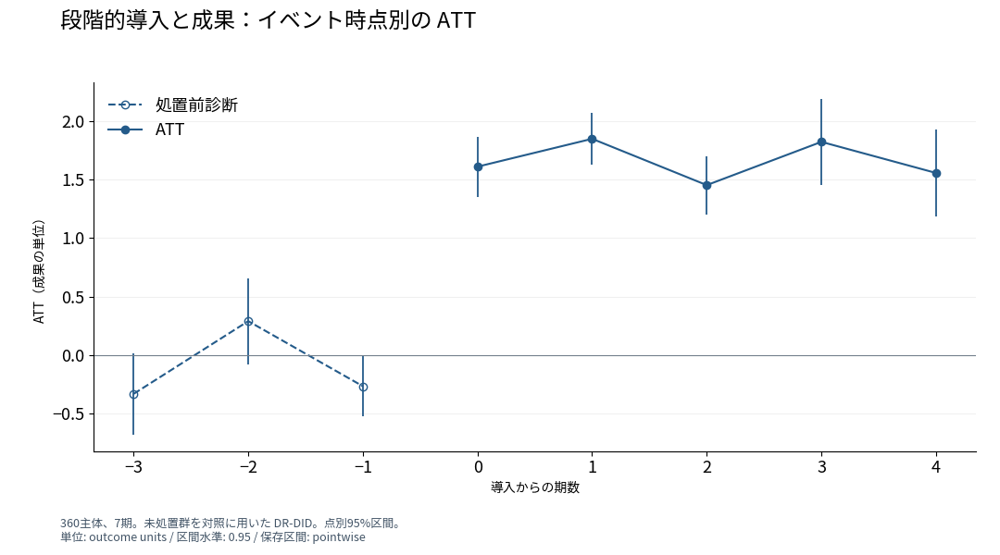

# 段階的な導入と成果の時間的推移

## Abstract

本稿は、導入時期が異なる処置の成果を、独自に生成されたパネルの推定結果から示す。未処置群を比較対象とする群・時点別ATTを導入からの経過期別に集約すると、導入後の平均効果は1.6588成果単位である。導入期の効果は1.6110、1期後は1.8491であり、成果の増加は導入期から現れる。経過0–2期には第3期導入群と第5期導入群が寄与し、経過3–4期には第3期導入群が寄与する。この対応によって、導入後の成果と各時点の推定対象を一緒に示す。

## Introduction

段階的な施策導入を評価するには、成果が変化する時点を導入時期にそろえる必要がある。本稿の問いは、処置群の成果が導入後のどの時点で増加するかである。推定結果では、導入後の平均ATTは1.6588成果単位であり、導入期から正の推定値を示す。導入期とその後の効果を同じ成果単位で比較することで、平均効果を構成する時間的な応答を明らかにする。

この比較は、処置開始が第3期または第5期の主体と、全期間未処置の主体から構成される。条件付き平行トレンド、共通支持、先取り行動がないという採用済みの識別条件の下で、群・時点別ATTを推定している。各導入群の処置前後の変化を、同じ時点の未処置群の変化と比較し、その結果を経過期別に集約する。各経過期の推定対象は、寄与する導入群と集約ウェイトによって定まる。

本稿がこの計算例で示す知見は、平均的な成果の増加が導入期から観測され、その後の経過期にも正の推定値が続くことである。各点に寄与する導入群を併記することによって、推定値の時間的な配置と対象集団の対応が分かる。経過期ごとの効果と導入群の対応が、平均効果の時間的な内容を定める。

## Identification

分析は360主体を7期間観測した人工データを用いる。結果変数は採用済み仕様の成果変数yであり、その測定単位は成果単位である。共変量xを用いた二重頑健な群・時点別推定を、未処置群を対照として実行している。導入後の比較基準は各群の処置直前期である。導入前は、各時点とその直前期との差を比較する。経過0–2期の集約では二つの導入群にそれぞれ0.5のウェイトを与え、経過3–4期では第3期導入群のウェイトが1となる。

## Results

導入後の平均ATTは1.6588成果単位であり、点別95%区間は[1.4442, 1.8733]である。導入期の推定値は1.6110、1期後は1.8491、2期後は1.4534である。これらの点は、両導入群を同じウェイトで集約した結果を示す。経過3期と4期の推定値は、それぞれ1.8230と1.5573である。

図1は、各経過期のATTと点別95%区間を示す。横軸は導入からの期数、縦軸は成果単位である。導入前1期の推定値は-0.2648であり、その区間は[-0.5189, -0.0106]である。導入前の共同検定のp値は0.11917である。

## Discussion

経過0–2期の結果は、二つの導入群に共通する観測期間で、成果の増加が導入期から現れることを示す。経過3–4期の結果が示すのは、第3期導入群のその後の成果である。経過3–4期の推定対象は第3期導入群であり、経過0–2期から対象集団が変わる。

成果変数yの正の応答は、採用済み識別条件の下で処置が成果を増加させるという答えを与える。両導入群が寄与する経過0–2期では、導入時点から正の推定値が続く。第3期導入群では、その後の2期間にも正の推定値が観測される。

## Conclusion

段階的な導入後の平均ATTは1.6588成果単位であり、成果の増加は導入期から現れる。経過0–2期は二つの導入群を、経過3–4期は第3期導入群を表す。両導入群で成果の増加が導入期から現れ、第3期導入群では経過4期まで正の応答が観測される。

## English abstract

We examine when outcomes respond to staggered treatment adoption in an independently generated panel. Group-time effects, estimated against never-treated units under conditional parallel trends, overlap, and no anticipation, imply an average post-treatment ATT of 1.6588 outcome units. The estimated effect is 1.6110 at adoption and 1.8491 one period later. Cohorts treated in periods 3 and 5 both contribute to event times 0–2; only the period-3 cohort contributes to event times 3–4. Reporting cohort composition alongside each estimate links the timing of the outcome response to the population represented by that estimate.

## Sources

- [Adopted specification](../../models/did-spec.json)
- [Executed result](../../models/did-result.json)
- [Saved figure](../../gallery-assets/specialist-did-r01-event-study-3a3ea95b1042de8457d5/display.svg)
