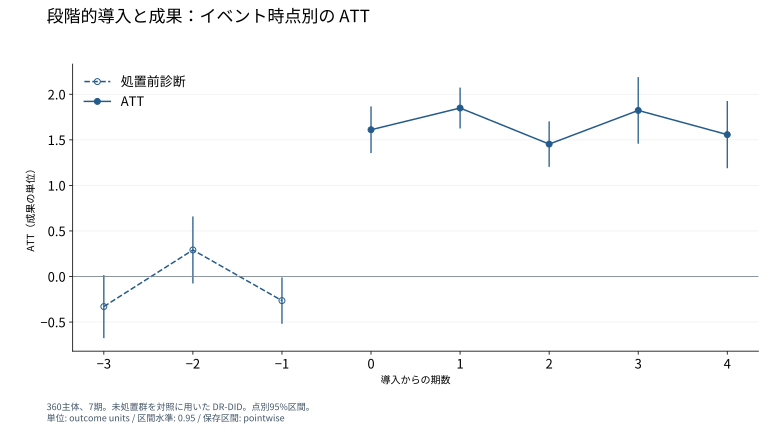

# 段階的導入後の成果と導入前の変化

## Abstract

本稿は、360主体・7期間の独自の人工パネルを用い、段階的な処置導入後に成果がいつ増加するかを調べる。未処置群を比較対象とする群・時点別ATTの経過期集約では、導入後平均は1.6588成果単位となり、導入期から正の推定値が現れる。導入前1期の平均変化は-0.2648成果単位で、点別95%区間はゼロを含まない。四つの導入前群・時点別対比の共同検定はp=0.11917となる。導入後の因果効果は、条件付き平行トレンド、共通支持、先取り行動なしを識別条件とする。経過0–2期の推定値は第3期・第5期導入群を、経過3–4期は第3期導入群を表す。

## Introduction

段階的な施策導入では、同じ暦年に観測される主体の処置経験が異なる。導入時期に成果の変化をそろえ、各時点で処置を受けた群と未処置群を比較すると、処置後の応答を群・時点別の効果として測定できる。本稿の問いは、この人工パネルで成果の増加が導入後のどの時点から現れるかである。経過0–2期に両導入群を等しく重み付けした推定値は正であり、導入期のATTは1.6110成果単位となる。

推定は共変量xを用いた二重頑健な群・時点別DiDに基づく。第3期導入群と第5期導入群の各処置後変化を、全期間未処置の主体の同じ暦期間の変化と対応させる。採用した条件付き平行トレンドは、処置がなかった場合の成果変化をこの比較で復元する条件である。共通支持と先取り行動なしを併せて置き、群・時点別ATTを導入からの経過期で集約する。

このパネルには、導入後の正の推定値と、導入直前の負の平均変化がある。導入前1期の点別検定と、導入前の全群・時点別対比を用いる共同検定は、それぞれの帰無仮説に対する結果を与える。さらに、導入後3期目からは第3期導入群が集約対象となる。導入前の対比は処置前の成果変化を捉え、各経過期の構成は時間的な応答の対象集団を定める。

## Identification

主体iの初回処置期をG_iとし、第3期導入群、第5期導入群、全期間未処置群を観測する。成果変数yの単位は成果単位である。各導入群は120主体を含む。処置後の推定対象は、群gに属する主体の群・時点別平均処置効果である。

$$ATT(g,t)=E[Y_{it}(g)-Y_{it}(0)\mid G_i=g],\qquad t\ge g.$$

処置後の変化は各群の導入直前期g−1を基準とする。導入前の診断では、採用したvarying基準に従い、時点t−1からtへの変化を未処置群と比較する。導入前の対比をd(g,t)と書くと、経過−1期の推定値は0.5d(3,2)+0.5d(5,4)に対応する。共同検定はd(3,2)、d(5,2)、d(5,3)、d(5,4)がすべてゼロという四つの制約を、その同時共分散で評価する。

経過0–2期のATTは両導入群に0.5ずつを与える。経過3–4期は第3期導入群に重み1を与える。導入後平均は、保存された経過0–4期の集約効果の平均である。推論は正規近似による解析的な点別95%区間を用いる。図の各区間は対応する一つの経過期の効果を対象とする。

## Results

導入後平均ATTは1.6588成果単位であり、95%区間は[1.4442, 1.8733]である。両導入群を等重みで集約した導入期の推定値は1.6110、1期後は1.8491、2期後は1.4534である。第3期導入群の経過3期と4期の推定値は、それぞれ1.8230と1.5573となる。

図1の横軸は初回導入からの経過期、縦軸は成果単位である。導入前の点は隣接期の成果変化の対比、導入期以降の点は群・時点別ATTの集約を示す。経過0–2期の各点は240主体、経過3–4期の各点は第3期導入群の120主体を表す。各縦線は正規近似による点別95%区間である。

導入前1期の推定値は-0.2648成果単位、点別95%区間は[-0.5189, -0.0106]、両側p値は0.04117である。この一つの加重平均がゼロという帰無仮説は5%水準で棄却される。四つの導入前対比を用いたWald統計量は7.3359、自由度は4、p値は0.11917となり、共同帰無仮説は5%水準で棄却されない。前者は導入直前の二つの群・時点別対比を集約し、後者は四つの対比を同時共分散で重み付けしている。

## Discussion

両導入群を等重みで集約した成果の増加は、導入期から経過2期まで現れる。この期間の推定対象は同じ二つの導入群である。経過3期と4期の正の推定値は、早期導入群のその後の応答を表す。長い経過期の結果を解釈する際の母集団は、第3期導入群の120主体となる。

導入直前には、処置群から未処置群を引いた成果変化の加重平均は-0.2648成果単位となる。点別検定はこの対比を、共同検定は四つの対比全体を評価する。導入後の推定値を因果効果と解釈する根拠は、未処置潜在成果に関する条件付き平行トレンド、共通支持、先取り行動なしである。導入前1期の平均変化がゼロという制約は、保存された点別推論で棄却される。

## Conclusion

条件付き平行トレンド、共通支持、先取り行動なしの下で、導入後平均ATTは1.6588成果単位となる。両導入群を等しく重み付けした推定値は導入期から正である。導入前1期の負の対比は点別5%検定で棄却域に入り、四つの導入前対比の共同検定はp=0.11917となる。経過3–4期は第3期導入群を表す。これらの識別条件と集約対象が、導入後の成果に関する結論を定める。

## English abstract

We examine the timing of the outcome response to staggered adoption in an independently generated panel of 360 units over seven periods. Group-time ATTs use never-treated controls under conditional parallel trends, overlap, and no anticipation. The average post-treatment ATT is 1.6588 outcome units, with positive estimates from adoption onward. The event-time −1 pretreatment contrast is -0.2648, and its pointwise 95% interval excludes zero. A joint Wald test of four pretreatment group-time contrasts yields p=0.11917. Event times 0–2 average the period-3 and period-5 cohorts with equal weights; event times 3–4 represent the period-3 cohort. These comparisons specify the identifying conditions and populations behind the estimated response.

## Sources

- [Adopted specification](../../models/did-spec.json)
- [Executed result, did 2.5.1](../../models/did-result.json)
- [Official base-period definition and joint Wald calculation](https://github.com/cran/did/blob/453a1be859411edc1c8933891940cb3a570d7095/R/att_gt.R)
- [Saved figure](../../gallery-assets/specialist-did-r01-event-study-3a3ea95b1042de8457d5/display.svg)
