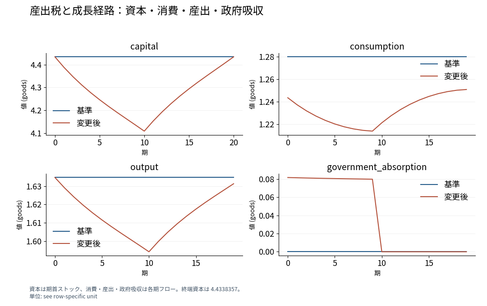

# 一時的な産出税と消費・資本の移行経路

## Abstract

本稿は、20期間の家計成長モデルを用いて、当初10期間の産出税が消費、資本蓄積、家計厚生に与える影響を示す。家計は対数消費の割引和を最大化し、初期資本と終端資本は同じ値に固定される。産出税を当初10期間だけ5%とすると、家計は消費と資本蓄積を減らし、課税終了後に終端条件へ向けて資本を回復させる。家計厚生の変化は-0.5436割引対数消費単位となる。この結果は、一時的な資源吸収が資本ストックを通じて課税終了後の消費にも作用することを示す。

## Introduction

一時的な課税は、課税期間の消費可能資源と、将来へ持ち越す資本の収益を変える。本稿は、この二つの経路が消費の時間配分と家計厚生にどう現れるかを、有限期間の成長モデルで調べる。計算では、当初10期間の5%の産出税によって、家計厚生は-0.5436割引対数消費単位変化する。消費と資本の経路を併せて読むと、この厚生変化を生む期間間の調整が分かる。

モデルの家計は、現在消費する資源と翌期の生産に用いる資本を配分する。税収は政府による資源吸収に充てられる。政府吸収と家計消費は資源制約にそれぞれ計上され、家計の目的関数は各期の消費から構成される。生産性、選好、生産技術、初期資本、終端資本をそろえて税率経路を変えることで、政策比較と家計の最適化を結び付ける。

この計算例が示すのは、税率がゼロへ戻る時点と、消費・資本が回復する時点の関係である。課税期間に減少した資本は、その後の産出にも影響する。家計は終端資本を満たすように蓄積を再開するため、課税終了後も消費の経路が基準ケースと異なる。この消費と資本の調整が、家計厚生の変化を生む。

## Model

代表的家計は、t=0,…,19について次の目的を最大化する。

$$W=\sum_{t=0}^{19}\beta^t\log c_t.$$

生産は$y_t=A_t k_t^\alpha$であり、家計の資源制約は次式となる。

$$c_t+k_{t+1}=(1-\tau_t)A_t k_t^\alpha+(1-\delta)k_t.$$

生産性は各期1である。採用済みパラメータは$\alpha=0.33$、$\beta=0.96$、$\delta=0.08$であり、いずれもモデル仕様で与えた値である。初期資本と終端資本は$k_0=k_{20}=4.4338357$とする。終端後の効用は目的関数に加算しない。基準ケースの税率は全期間ゼロ、変更ケースではt=0,…,9の税率を0.05、t=10,…,19をゼロとする。

内点の消費・資本配分は、資源制約と次のEuler条件を満たす。

$$\frac{1}{c_t}=\beta\frac{(1-\tau_{t+1})\alpha A_{t+1}k_{t+1}^{\alpha-1}+1-\delta}{c_{t+1}},\qquad t=0,\ldots,18.$$

この式では、現在消費を1単位減らして増やした資本の税引後収益を、翌期の限界効用で評価する。家計はこの期間間の条件と両端の資本条件を同時に満たす経路を選ぶ。

## Results

基準ケースでは資本が4.4338357で一定となり、各期の消費は1.2799901である。変更ケースでは第0期の消費が1.2436075となり、資本は第10期に4.1094346へ低下する。第10期に税率がゼロへ戻った後、家計は資本を蓄積して第20期の終端条件を満たす。第10期の消費は1.2213150、最終消費期の第19期は1.2509494である。

図1は、資本の期首ストックと、消費・産出・政府吸収の各期フローを同じシナリオで対応させる。課税期間には政府吸収が正となり、第10期からゼロとなる。資本と産出の経路は、課税終了後も家計の資源配分に作用する。

家計厚生は基準ケースの3.4435757から変更ケースの2.8999706へ変化する。その差は-0.5436割引対数消費単位である。各期の消費を対数効用に変換し、同じ割引率で20期間について合計した値を比較している。

## Discussion

産出税は、家計が消費または投資に利用できる産出を減らすとともに、課税期間の資本収益を下げる。家計は資本の取り崩しによって消費を調整する。取り崩した資本は後続期間の生産を減らすため、税率の変更は資本蓄積を通じて時間的に波及する。

課税終了後には税引後収益が回復し、終端資本を満たす蓄積が進む。その過程でも、家計は消費と投資を配分する。したがって、税率がゼロへ戻る時点の政策変更は、資本の回復経路を経由して消費へ伝わる。家計厚生の低下は、この20期間の消費経路を同じ目的関数で評価した結果である。

## Conclusion

当初10期間の産出税は、家計の消費可能資源と資本収益を変え、資本ストックを通じて課税終了後の消費へ波及する。初期資本と終端資本を固定した20期間の比較で、家計厚生の変化は-0.5436割引対数消費単位である。課税終了後の資本回復に必要な投資が、残る期間の消費配分を変える。

## Appendix: numerical solution

変更ケースの数値解では、Euler条件の最大絶対残差が3.1359951×10⁻⁷、資源制約の最大絶対残差が0である。パラメータ表は選好・技術・両端資本を示し、残差表は計算された経路と元の方程式の対応を示す。

## English abstract

We study how temporary output taxation changes consumption, capital accumulation, and household welfare in a twenty-period growth model. The household maximizes discounted log consumption with fixed initial and terminal capital. A five-percent output tax in the first ten periods reduces consumption and capital accumulation. Capital subsequently recovers to meet the terminal condition, while consumption remains below its baseline path. Household welfare changes by -0.5436 units of discounted log consumption. The allocation paths show how temporary resource absorption propagates beyond the tax period through the capital stock.

## Sources

- [Adopted specification](../../models/growth-spec.json)
- [Executed result](../../models/growth-result.json)
- [Producing equations](../../models/historical-producers/research_macro-registration.py)
