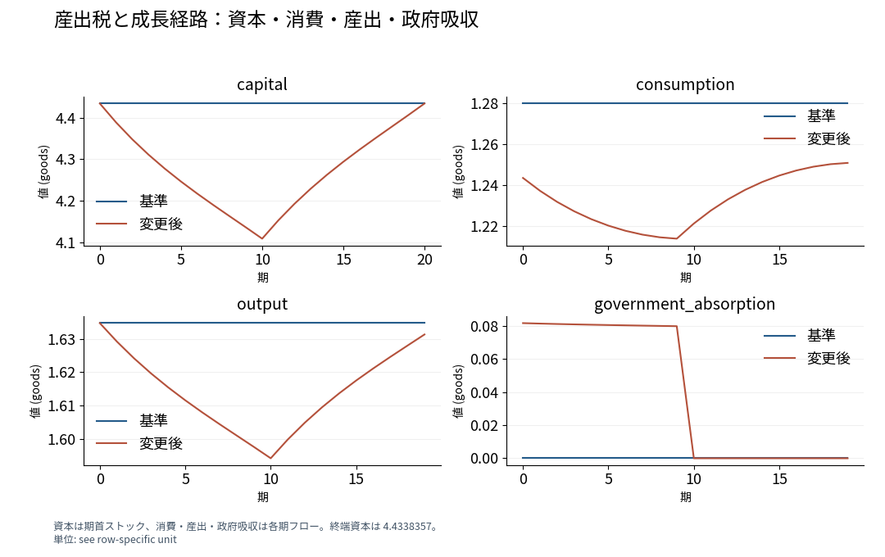

# 保存結果に基づく日英改稿・翻訳と読者別の説明

以下の原文は、保存済みの人工パネル、人工市場、成長モデルの計算例に基づいて本例用に作成した。各例に原文、完成文、保持した研究内容と出典を示す。

## 1. 日本語の短文改稿：段階的導入のATT

### 原文

未処置群との比較による群・時点別ATTの経過期集約により、人工パネルの導入後平均は1.6588成果単位、点別95%区間は[1.4442, 1.8733]となる。条件付き平行トレンド、共通支持、先取りなしが識別条件である。経過0–2期についての第3期導入群と第5期導入群のウェイトは各0.5で、3–4期での対象は第3期導入群である。

### 完成改稿文（revise）

人工パネルの群・時点別ATTを導入からの経過期別に集約すると、導入後の平均ATTは1.6588成果単位となる（点別95%区間[1.4442, 1.8733]）。推定は未処置群を比較対象とし、条件付き平行トレンド、共通支持、先取り行動がないことを識別条件とする。経過0–2期は第3期導入群と第5期導入群を0.5ずつのウェイトで集約し、経過3–4期は第3期導入群の効果を示す。

### 英訳（translate）

Aggregating group-time ATTs by event time in the synthetic panel yields an average post-treatment ATT of 1.6588 outcome units, with a pointwise 95% confidence interval of [1.4442, 1.8733]. Estimation uses never-treated units as controls under conditional parallel trends, overlap, and no anticipation. The period-3 and period-5 cohorts each receive a weight of 0.5 at event times 0–2; estimates at event times 3–4 represent the period-3 cohort.

### 保持した研究固有内容

| 内容 | 原文・完成文・英訳で共有する定義と数量 |
| --- | --- |
| 推定対象 | 人工パネルの群・時点別ATTを経過期別に集約した導入後平均 |
| 比較と識別 | 全期間未処置の主体、条件付き平行トレンド、共通支持、先取り行動なし |
| 数量と単位 | ATT 1.6588成果単位、点別95%区間[1.4442, 1.8733] |
| 寄与する群 | 経過0–2期は第3期・第5期導入群に各0.5、経過3–4期は第3期導入群 |

出典：[原稿](causal-paper.md)、[採用仕様](../../models/did-spec.json)、[保存結果](../../models/did-result.json)の`coefficients.overall`、`inference`、`diagnostics.aggregation_components`。

## 2. 英語の短文改稿：企業統合と市場0の厚生

### 原文

A re-solution of all firms' prices was conducted after the merger of firms 0 and 1 in a model estimated from 120 synthetic markets, with fitted demand and marginal costs kept fixed. Common ownership brings substitution between products 0 and 1 into the merged firm's pricing decision. Market 0 had a movement of the price of product 0 from 2.1413 to 2.2161 synthetic currency units. The movements of consumer surplus and total surplus were from 0.5500 to 0.5388 and from 1.0220 to 1.0154, respectively, in synthetic currency units per potential consumer.

### 完成改稿文（revise）

In the model estimated from 120 synthetic markets, we merge firms 0 and 1, hold fitted demand and marginal costs fixed, and solve for all firms' new equilibrium prices. The merged firm accounts for substitution between products 0 and 1 when setting prices. In market 0, the price of product 0 rises from 2.1413 to 2.2161 synthetic currency units. Consumer surplus falls from 0.5500 to 0.5388, and total surplus falls from 1.0220 to 1.0154, both measured in synthetic currency units per potential consumer.

### 和訳（translate）

120の人工市場から推定したモデルで企業0と1を統合し、推定済みの需要と限界費用を固定して全企業の均衡価格を解き直す。統合企業は、製品0と1の間の代替を価格設定に織り込む。市場0では、製品0の価格が2.1413から2.2161へ上昇する。潜在消費者1人当たりの消費者余剰は0.5500から0.5388へ、総余剰は1.0220から1.0154へ低下する。価格と余剰は、この人工データの通貨単位で測る。

### 保持した研究固有内容

| 内容 | 原文・完成文・和訳で共有する定義と数量 |
| --- | --- |
| 推定と介入 | 120の人工市場からの需要・供給推定、製品0と1を所有する企業0と1の統合 |
| 固定する対象 | 推定済みの需要と各製品の限界費用 |
| 解き直す対象 | 所有変更後の全企業の均衡価格 |
| 機序 | 統合企業による製品0・1間の代替の内部化 |
| 市場0の結果 | 製品0の価格2.1413→2.2161、消費者余剰0.5500→0.5388、総余剰1.0220→1.0154 |
| 厚生の定義 | 総余剰は消費者余剰と生産者余剰の和。余剰の単位は潜在消費者1人当たりの人工データ通貨単位 |

出典：[原稿](structural-paper.md)、[採用仕様](../../models/blp-supply-spec.json)、[保存結果](../../models/blp-supply-result.json)の`adopted.sources`、`displays.equilibrium_products.rows`、`displays.welfare.rows`。機序は原稿の複数製品企業の価格設定条件に基づく。

## 3. 同じ成長モデル結果の読者別説明

### 経済学研究者向けの完成段落（compose）

初期・終端資本を$k_0=k_{20}=4.4338357$に固定した20期間の代表的家計成長モデルで、第0–9期の産出税を5%、第10–19期をゼロとする。税収を政府吸収に充てる資源制約とEuler条件の下で、資本は第10期に4.1094346まで低下し、その後は終端条件へ向けて回復する。課税終了後も家計は資本回復に財を配分し、消費は第10期の1.2213150から第19期の1.2509494へ増加する経路を取る。この消費経路は無税時の各期1.2799901を下回り、$W=\sum_{t=0}^{19}0.96^t\log c_t$で評価した家計厚生は、基準ケースの3.4435757から2.8999706へ低下する。その差は−0.5436割引対数消費単位となる。

### 経済学未修読者が指定された場合の完成段落（explain）

この20期間のモデルでは、家計は手元の財を消費に使うか、翌期の生産に使う資本として残すかを選ぶ。政府が第0–9期に産出の5%を使うと、家計に残る財が減り、家計は消費と翌期へ持ち越す資本を減らす。第10期の資本は、初期の4.4338357から4.1094346へ低下する。20期間の終了時には資本を初期値へ戻す条件があるため、家計は課税が終わった後も生産物の一部を資本の回復に回す。[図1](../../gallery-assets/specialist-growth-r01-displays-allocation_paths-d55459efb1b0d349b220/display.png)の左上にその資本の回復、右上に消費の回復が表れる。消費は第10期の1.2213150から第19期の1.2509494へ増える。課税終了後のこの消費経路も、課税がない場合の各期1.2799901を下回る。各期の消費の対数に、第0期を1として1期先ごとに0.96倍する重みを付けて合計した家計厚生は、3.4435757から2.8999706へ低下する。その差は−0.5436割引対数消費単位となる。

図1の青線は無税の基準ケース、赤線は当初10期間に5%の産出税を課すケース。横軸はモデルの期、縦軸は財の単位である。資本は各期の期首ストック、消費・産出・政府吸収は各期のフローを示す。第10期に政府吸収がゼロとなり、家計は第20期の資本を4.4338357へ戻す。

### 保持した研究固有内容

| 内容 | 二つの完成段落が用いる共通の仕様と結果 |
| --- | --- |
| 主体と期間 | 代表的家計1主体、第0–19期の20期間 |
| 資本条件 | 初期資本と終端資本を4.4338357に固定 |
| 政策比較 | 全期間無税と、第0–9期5%・第10–19期ゼロの産出税 |
| 資源の使途 | 税収は政府吸収、家計は消費と翌期の資本を選択 |
| 技術と選好 | 生産性は各期1、資本分配率0.33、減耗率0.08、割引因子0.96 |
| 経路 | 変更ケースの第10期資本4.1094346、消費は第10期1.2213150・第19期1.2509494、無税時の消費は各期1.2799901 |
| 家計厚生 | 第0–19期の割引対数消費和。基準3.4435757、変更後2.8999706、差−0.5436割引対数消費単位。評価期間は第19期まで |

出典：[原稿](growth-paper.md)、[採用仕様](../../models/growth-spec.json)、[保存結果](../../models/growth-result.json)の`definition`、`baseline`、`scenario`、`welfare_change`、`displays.welfare`。図1は保存済みの成長経路図を使用した。
