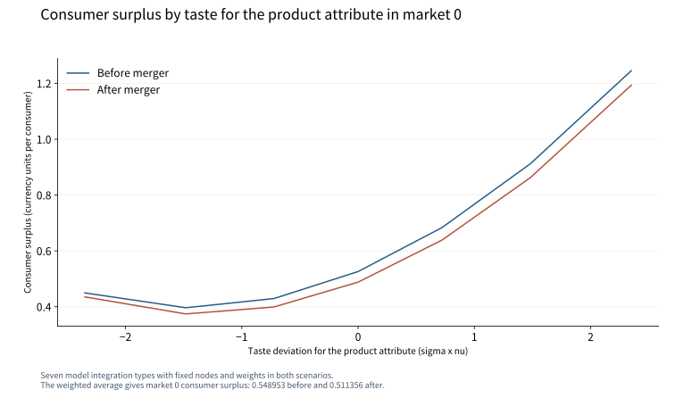
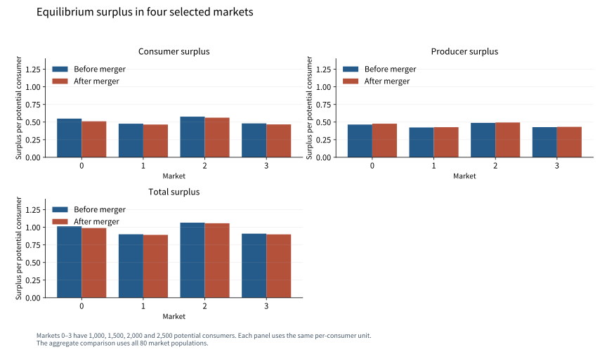

# 消費者の嗜好と企業統合後の厚生配分

## Abstract

本稿は、消費者の製品属性への嗜好が異なる80市場の数値経済を用い、企業統合による価格調整が主体別・市場別の厚生にどう現れるかを調べる。需要・供給を同時に推定し、限界費用と嗜好分布を保持して、各市場の企業0と1を統合する。全企業が価格を調整した均衡では、14万人の消費者余剰の変化は-3081.4357 合成通貨単位、生産者余剰の変化は906.6882 合成通貨単位、総余剰の変化は-2174.7475 合成通貨単位となる。市場0では、統合企業の製品を高く評価する嗜好型ほど消費者余剰の低下が大きい。所有による代替需要の内部化と、消費者の選択確率の違いが、利潤増加と厚生損失の配分を結び付ける。

## Introduction

二つの製品を別々に販売していた企業が統合すると、一方の値上げに伴って他方へ移る需要が、統合企業の利潤に入る。この価格設定の変化が消費者に与える影響は、各製品をどの程度好むかによって変わる。本稿の問いは、嗜好の異質性を伴う企業統合について、価格と選択の調整が、消費者間の損失と市場全体の厚生にどのように現れるかである。

この問いを、各市場に4製品がある80市場の数値経済で分析する。製品属性xへの嗜好を正規分布で表し、価格の効用係数、平均的な属性評価、嗜好の分散、費用関数を需要・供給モーメントから推定する。各市場で製品0と1の所有を統合し、同じ限界費用で全4製品の価格を解き直す。消費者余剰と企業利潤を、それぞれの市場人口で集計する。

価格の内生性と厚生評価を結ぶには、どの観測変動と制約が需要を規律するかを定める必要がある。[MacKay and Miller (2025)](https://doi.org/10.1257/mic.20230024)は、需要・費用ショックの共分散制約から価格係数を識別する関係を示している。本稿の推定では、独立に生成した費用シフターzと製品属性xの排除条件を、需要・供給の操作変数モーメントに用いる。そのパラメータから所有変更後の均衡を計算し、同じ消費者分布について厚生を比較する。

この数値経済で得られる中心的な知見は、統合後の利潤増加と消費者の損失が、製品間の代替と嗜好の分布を通じて結び付くことである。市場0の嗜好別比較は、統合製品を高く評価する型がより大きい損失を負うことを示す。80市場を人口で集計すると、消費者余剰の減少が生産者余剰の増加を上回り、総余剰が低下する。この集計に必要な重みは、消費者の嗜好分布と各市場の潜在人口である。

## Model and identification

市場tの消費者iは、4製品と外部選択肢から一つを選ぶ。製品jの効用は

$$u_{ijt}=\beta_0+\beta_p p_{jt}+(\beta_x+\sigma_x\nu_i)x_{jt}+\xi_{jt}+\varepsilon_{ijt},\qquad \nu_i\sim N(0,1)$$

である。外部選択肢の確定的効用を0とし、εは標準極値分布に従う。βpは全消費者に共通する負の価格係数である。xは製品属性、ξは需要ショックを表す。属性への係数βx+σxνiが、消費者ごとの製品間の代替を決める。限界費用は

$$mc_{jt}=\gamma_0+\gamma_z z_{jt}+\omega_{jt}$$

とする。xとzはそれぞれ区間[−1,1]から独立に生成し、ξとωはそれらから独立な平均0、標準偏差0.03の正規変数とする。データ生成時の係数は、効用の定数1、価格−1.2、属性平均0.6、属性の標準偏差0.7、費用の定数1.4、zの係数0.3である。市場人口は1,000、1,500、2,000、2,500人を20回繰り返し、合計14万人とする。

需要のモーメントは$E[Z_D\xi]=0$、供給のモーメントは$E[Z_S\omega]=0$である。需要の操作変数には自製品のz、競合製品のxの和、xの二乗和、zの和を用い、外生的な定数と自製品のxを含める。供給側には自製品と競合製品のxを用い、定数とzを含める。zが価格を動かす変動と需要からの排除が価格係数を規律し、製品属性の市場間変動と正規嗜好の制約がσxを含む代替構造を規律する。価格とシェアは、消費者の選択と企業の価格設定を同時に満たす観測値である。

企業fは製品集合$\mathcal J_f$の利潤を最大化する。潜在消費者に対するシェアを$s_{jt}(p_t)$とすると、価格設定条件は

$$s_{jt}(p_t)+\sum_{k\in\mathcal J_f}(p_{kt}-mc_{kt})\frac{\partial s_{kt}(p_t)}{\partial p_{jt}}=0$$

となる。需要推定値とこの条件から限界費用を回収する。PyBLPによる1段階GMMで需要と供給を同時推定し、嗜好の積分には7点の求積を用いた。統合後は製品0と1を同じ企業集合に入れ、全製品の価格とシェアを再計算した。均衡計算は観測価格を初期値とし、保存結果の利潤勾配と曲率が示す解を用いる。

表1は、需要と費用を結ぶ推定値を示す。価格係数は-1.1999、属性の平均係数は0.5903、その標準偏差は0.6265である。これらが同じ製品構成に対する嗜好型別の選択確率を決める。費用シフターの係数0.3026と費用の定数が、供給モーメントと価格設定条件を通じて回収される。

表1　需要・供給パラメータ。320製品・市場観測の同時GMM推定。標準誤差は保存された公式推定結果を用いる。

| パラメータ | 推定値 | 標準誤差 |
| --- | ---: | ---: |
| 効用の定数 β₀ | 1.0129 | 0.0276 |
| 価格係数 βₚ | -1.1999 | 0.0139 |
| 属性の平均係数 βₓ | 0.5903 | 0.0077 |
| 属性係数の標準偏差 σₓ | 0.6265 | 0.0740 |
| 限界費用の定数 γ₀ | 1.4016 | 0.0098 |
| 費用シフターの係数 γ_z | 0.3026 | 0.0032 |

## Results

### 所有と価格・シェアの調整

市場0では、製品0の価格が2.1015から2.2201へ、製品1の価格が2.2334から2.3999へ上昇する。両製品のシェアは、それぞれ0.1590から0.1445、0.1182から0.1013へ低下する。競合製品2と3も価格を調整し、シェアは0.0581から0.0603、0.1425から0.1480へ上昇する。統合企業の値上げに対して、消費者が競合製品へ代替する動きが現れている。

この価格反応は、統合企業の最適化条件に加わる交差価格効果と対応する。製品0を値上げすると、製品1へ移った需要からも利潤を得る。旧価格で正となる追加の限界利潤が値上げの誘因を生み、競合企業も変化した需要に対して価格を調整する。厚生計算には、この同時調整後の価格とシェアを用いる。

### 嗜好型と市場ごとの厚生

図1は、市場0の各求積点における消費者余剰を示す。横軸は属性係数の平均からの偏差σxνiである。平均型の余剰は0.5260から0.4880へ変わり、図の最も高い属性評価の型では1.2455から1.1936へ変わる。最も低い評価の型では0.4494から0.4351への変化となる。市場0では統合製品0と1のxがともに正であり、これらを高く評価する型ほど値上げの影響を強く受ける。

7点は、推定した正規嗜好分布を積分する節点である。各点の余剰を保存された求積重みで合計すると、市場0の潜在消費者1人当たり余剰は0.5490から0.5114へ変わる。同じ節点と重みを統合前後に用いるため、両シナリオは同じ嗜好分布に属する消費者を比較している。

市場0–3の比較を付録図A1に示す。市場ごとの属性、費用、シェアが、統合製品への代替可能性と価格反応を変える。これら4市場では消費者余剰が低下し、生産者余剰が増加し、総余剰が低下する。市場間の水準と変化の大きさを1人当たり単位で比較し、全市場の集計にはそれぞれの人口を用いる。

### 同じ人口で集計した厚生

表2は80市場の14万人について集計した厚生を示す。消費者余剰は66057.5670 合成通貨単位から62976.1313 合成通貨単位へ、生産者余剰は57660.7345 合成通貨単位から58567.4226 合成通貨単位へ変わる。両者の和は123718.3015 合成通貨単位から121543.5540 合成通貨単位へ低下する。

表2　80市場の厚生。単位は合成通貨単位。全市場で同じ潜在人口を用い、各市場の1人当たり余剰に人口を掛けて合計した。

| 余剰 | 統合前 | 統合後 |
| --- | ---: | ---: |
| 消費者余剰 | 66057.5670 | 62976.1313 |
| 生産者余剰 | 57660.7345 | 58567.4226 |
| 総余剰 | 123718.3015 | 121543.5540 |

消費者余剰には、共通する価格の限界効用で割った期待最大効用を用いる。

$$CS_t=\sum_i w_i\frac{\log\left[1+\sum_j\exp(\beta_0+\beta_p p_{jt}+\beta_x x_{jt}+\xi_{jt}+\sigma_x\nu_i x_{jt})\right]}{-\beta_p}.$$

企業の変動利潤を$PS_t=\sum_j(p_{jt}-mc_{jt})s_{jt}$とすると、総余剰は$W=\sum_tM_t(CS_t+PS_t)$である。消費者の支払は効用から控除され、企業の収入に入る。両者の合計では、財への評価と生産の資源費用が配分を評価する。採用した経済では税、固定費、調整費を0とし、外部選択肢、製品集合、限界費用、人口を統合前後で固定する。

## Discussion

統合による所有の変化は、価格設定条件を通じて消費者の配分を変える。合併した企業は自社製品間の需要の移転を利潤に取り込み、均衡では統合製品の価格が上昇する。消費者は各製品と外部選択肢の間で選択を変え、競合企業の販売と利潤も変化する。市場0の価格・シェアと嗜好別の余剰は、この一連の反応を同じ推定モデルの下で示している。

同じ価格変更でも、各消費者が統合製品を選ぶ確率によって損失が変わる。図1の横軸が表す属性への選好と、市場0で統合された製品の正の属性が、その関係を作る。嗜好型ごとの余剰を市場平均へ、さらに市場人口で全体へ集約することで、分布上の影響と総余剰を同じ計算に結び付けられる。

人口集計では、生産者余剰の増加と消費者余剰の減少を同じ通貨単位で足すと、総余剰が低下する。限界費用を固定した所有変更によって、価格設定と購入先の配分が変わり、この損失が生じる。共通する人口と嗜好の重みで両シナリオを集計することで、この総余剰の変化を同じ14万人が受ける影響として評価できる。

## Conclusion

嗜好の異なる消費者を含む80市場で、企業0と1の統合後の価格とシェアを解き直した。14万人で集計した総余剰の変化は-2174.7475 合成通貨単位である。統合企業が製品間の代替を内部化することが価格調整を生み、各製品を選ぶ確率の違いが消費者間の損失を決める。嗜好別の余剰と市場人口を保持した集計により、利潤増加、消費者の損失、総余剰の低下を同じ均衡から説明できる。

## English abstract

We study how heterogeneous preferences shape the distribution of merger effects in an independently generated economy with 80 four-product markets. We jointly estimate demand and supply, merge firms 0 and 1 at fitted marginal costs, and solve all firms' prices under the new ownership structure. For the same 140,000 potential consumers, the changes in consumer surplus, producer surplus, and total surplus are -3081.4357, 906.6882, and -2174.7475 synthetic currency units. In market 0, consumers with stronger preferences for the merging products' positive attribute incur larger surplus losses. The pricing conditions connect internalized substitution to equilibrium prices, while type-specific choice probabilities and market populations determine the distribution and aggregate value of the welfare change.

## Appendix: 市場間の比較と計算

図A1は市場0–3の消費者余剰、生産者余剰、総余剰を共通の1人当たり通貨単位で示す。4市場の潜在人口は順に1,000、1,500、2,000、2,500人である。本文の全市場比較は80市場すべてを含む。

保存結果のシェア再現誤差の最大値は9.7145e-16、統合後の利潤一階条件残差の最大値は5.2628e-14である。企業の利潤Hessianの最大固有値は-0.0542である。観測価格から解いた均衡について、価格設定条件と各企業の局所的な利潤最大化を確認している。7つの嗜好型の余剰を同じ重みで平均した値は、公式関数の市場平均余剰と一致する。

## Sources

- [Adopted specification and original synthetic observations](../../models/blp-random-merger.json)
- [Executed PyBLP 1.3.0 result](../../models/blp-random-merger-result.json)
- [Saved result and figure registry](../../gallery.json)
- MacKay, Alexander, and Nathan H. Miller. 2025. “Estimating Models of Supply and Demand: Instruments and Covariance Restrictions.” *American Economic Journal: Microeconomics* 17(1): 238–281. [DOI](https://doi.org/10.1257/mic.20230024).
- PyBLP. [Consumer surplus by market and integration type](https://pyblp.readthedocs.io/en/stable/_api/pyblp.ProblemResults.compute_consumer_surpluses.html).
